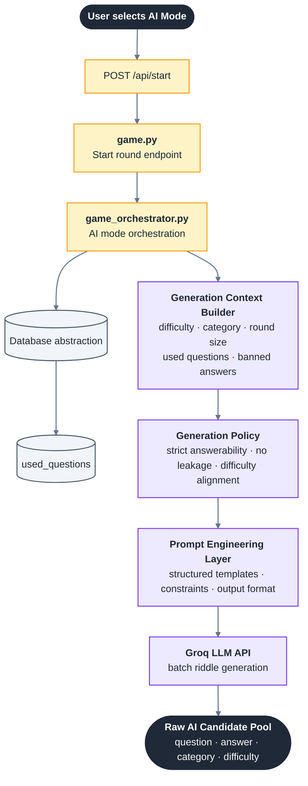
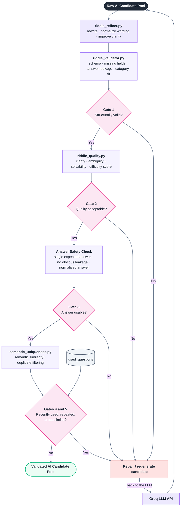
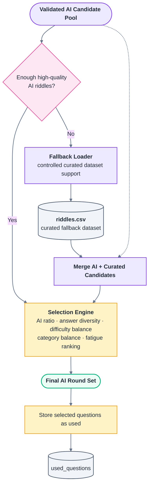
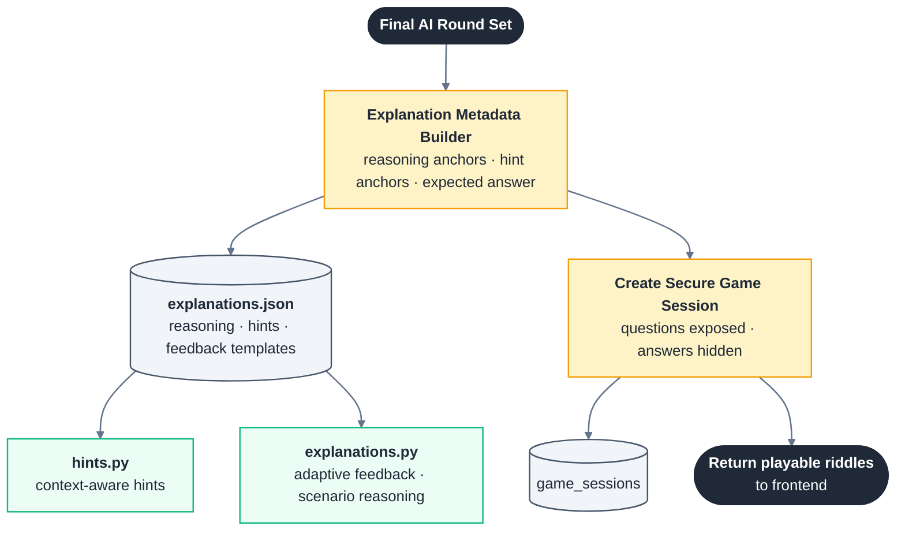
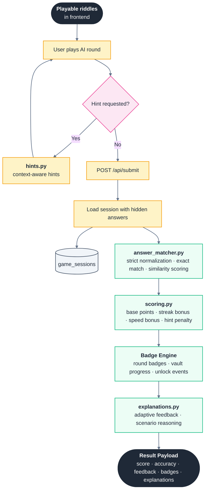
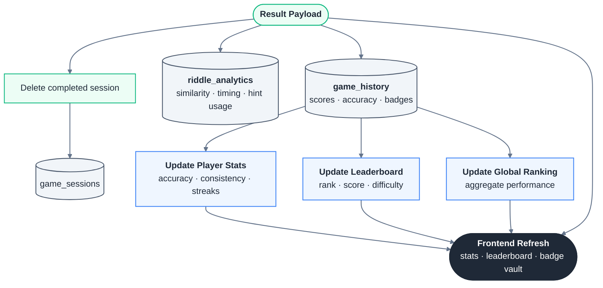
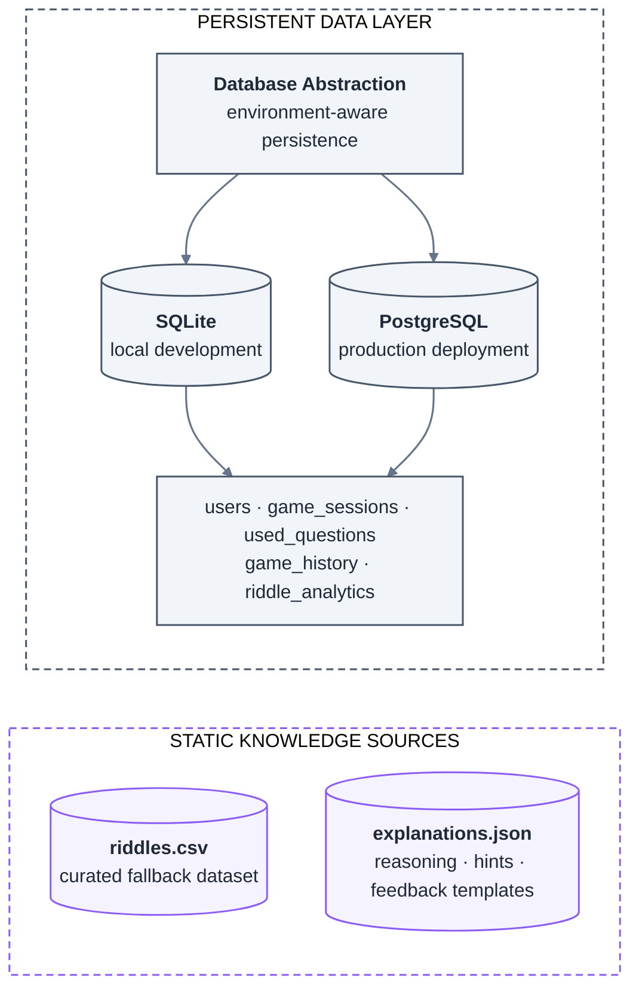

# Generative AI Pipeline

### How AI Mode generates, refines, validates, filters and selects riddles before a player ever sees them

 

  
  
  
  
  

---

The Generative AI pipeline powers **AI Mode** by generating, refining, validating, filtering, and selecting riddles before they are shown to the player.

The pipeline is intentionally controlled: **AI-generated content is not trusted blindly.** Every generated riddle must pass structural validation, quality checks, semantic uniqueness filtering, answer-safety checks, and anti-repetition rules before it becomes part of an active round.

The system supports:

- Groq-powered LLM generation
- Prompt-driven riddle creation
- Refinement and validation loops
- Semantic duplicate filtering
- Dataset fallback when AI quality is insufficient
- SQLite for local development
- PostgreSQL for production persistence

## Contents

1. [Pipeline at a Glance](#1-pipeline-at-a-glance)
2. [End-to-End Overview](#2-end-to-end-overview)
3. [Entry and Generation Context](#3-entry-and-generation-context)
4. [The Quality Gate Loop](#4-the-quality-gate-loop)
5. [Fallback and Final Selection](#5-fallback-and-final-selection)
6. [Metadata and Session Creation](#6-metadata-and-session-creation)
7. [Gameplay and Evaluation](#7-gameplay-and-evaluation)
8. [Results, Persistence and Feedback](#8-results-persistence-and-feedback)
9. [Data and Knowledge Sources](#9-data-and-knowledge-sources)
10. [Module Map](#10-module-map)
11. [Complete End-to-End Diagram](#11-complete-end-to-end-diagram)

---

## 1. Pipeline at a Glance

| Stage | What happens | Key component |
|---|---|---|
| **Context** | Builds the generation context: difficulty, category, round size, used questions, banned answers | `game_orchestrator.py` |
| **Policy and prompt** | Applies strict answerability, no-leakage and difficulty-alignment rules through structured prompt templates | Prompt engineering layer |
| **Generation** | Batch riddle generation | Groq LLM API |
| **Refinement** | Rewrites, normalises wording, improves clarity | `riddle_refiner.py` |
| **Quality gates** | Structure, quality, answer safety, semantic uniqueness, anti-repetition | Validators and checks (section 4) |
| **Fallback** | Controlled curated-dataset support when too few AI riddles survive | `riddles.csv` |
| **Selection** | AI ratio, answer diversity, difficulty and category balance, fatigue ranking | Selection engine |
| **Session** | Questions exposed, answers hidden on the server | `game_sessions` |

> [!IMPORTANT]
> A riddle reaches a player only after it has passed every gate. Anything that fails is repaired or regenerated, never shown as-is.

---

## 2. End-to-End Overview

```mermaid
%%{init: {
  "theme": "base",
  "themeVariables": {
    "fontFamily": "Inter, Segoe UI, Helvetica, Arial, sans-serif",
    "primaryTextColor": "#1f2937",
    "lineColor": "#64748b"
  },
  "flowchart": { "curve": "basis", "nodeSpacing": 26, "rankSpacing": 40, "htmlLabels": true }
}}%%
flowchart LR
    A(["<b>User selects<br/>AI Mode</b>"]) --> B["<b>Context and<br/>policy</b>"]
    B --> C["<b>Prompt and<br/>LLM generation</b>"]
    C --> D["<b>Refine and<br/>quality gates</b>"]
    D --> E["<b>Duplicate and<br/>fatigue control</b>"]
    E --> F{"<b>Enough<br/>AI riddles?</b>"}
    F -->|"Yes"| G["<b>Selection<br/>engine</b>"]
    F -->|"No"| H[("<b>Curated<br/>fallback</b>")]
    H --> G
    G --> I["<b>Secure session</b><br/>answers hidden"]
    I --> J["<b>Play</b>"]
    J --> K["<b>Evaluate and<br/>persist</b>"]

    classDef entry    fill:#1f2937,stroke:#1f2937,color:#ffffff;
    classDef ai       fill:#ede9fe,stroke:#7c3aed,stroke-width:1.5px,color:#1f2937;
    classDef decision fill:#fce7f3,stroke:#ec4899,stroke-width:1.5px,color:#1f2937;
    classDef store    fill:#f1f5f9,stroke:#475569,stroke-width:1.5px,color:#1f2937;
    classDef game     fill:#fef3c7,stroke:#f59e0b,stroke-width:1.5px,color:#1f2937;
    classDef score    fill:#ecfdf5,stroke:#10b981,stroke-width:1.5px,color:#1f2937;
    class A entry;
    class B,C,D,E ai;
    class F decision;
    class H store;
    class G,I,J game;
    class K score;
    linkStyle default stroke:#64748b,stroke-width:1.6px
```

---

## 3. Entry and Generation Context

AI Mode starts with `POST /api/start`. The orchestrator builds a generation context, applies the generation policy, and wraps both in a structured prompt before calling the Groq LLM for a batch of candidate riddles.

---

## 4. The Quality Gate Loop

This is the heart of the pipeline. Every raw candidate is refined, then must clear five gates in turn. **Any failure sends the candidate back for repair or regeneration**, which loops through the LLM again.

| Gate | Component | What it checks | On failure |
|:---:|---|---|---|
| **1** | `riddle_validator.py` | Schema, missing fields, answer leakage, category fit | Repair / regenerate |
| **2** | `riddle_quality.py` | Clarity, ambiguity, solvability, difficulty score | Repair / regenerate |
| **3** | Answer safety check | Single expected answer, no obvious leakage, normalised answer | Repair / regenerate |
| **4** | `semantic_uniqueness.py` | Semantic similarity and duplicate filtering | Repair / regenerate |
| **5** | `used_questions` memory | Recently used, repeated, or too similar to earlier questions | Repair / regenerate |

---

## 5. Fallback and Final Selection

Validated AI riddles form a candidate pool. If there are not enough high-quality ones, the **fallback loader** brings in curated riddles from `riddles.csv` as controlled support. The selection engine then builds the final round and records the chosen questions as used.

---

## 6. Metadata and Session Creation

For each final question the system builds explanation metadata (reasoning anchors, hint anchors, expected answer), which feeds the hint and explanation engines. It then creates a **secure game session** that exposes the questions and keeps the answers hidden.

> [!NOTE]
> Correct answers stay in the server-side session. The frontend only ever receives the questions.

---

## 7. Gameplay and Evaluation

The player works through the round, optionally requesting hints. On submission, the backend loads the session with its hidden answers, matches and scores the round, evaluates badges, and builds the result payload.

---

## 8. Results, Persistence and Feedback

The result payload is saved to history and analytics, the completed session is deleted, and the player's stats, leaderboard position and global ranking are refreshed on the dashboard.

---

## 9. Data and Knowledge Sources

The pipeline reads from two static sources and one persistent database layer. The database abstraction is environment-aware: the same interface sits over SQLite locally and PostgreSQL in production.

| Store | Holds |
|---|---|
| `riddles.csv` | Curated fallback dataset |
| `explanations.json` | Reasoning, hints and feedback templates |
| `users` | Player identity |
| `game_sessions` | Active AI rounds and hidden answers |
| `used_questions` | Anti-repetition memory |
| `game_history` | Scores, accuracy, badges |
| `riddle_analytics` | Similarity, timing, hint usage |

---

## 10. Module Map

| Component | Responsibility |
|---|---|
| `game.py` | Start-round endpoint |
| `game_orchestrator.py` | AI-mode orchestration |
| Generation Context Builder | Difficulty, category, round size, used questions, banned answers |
| Generation Policy | Strict answerability, no leakage, difficulty alignment |
| Prompt Engineering Layer | Structured templates, constraints, output format |
| Groq LLM API | Batch riddle generation |
| `riddle_refiner.py` | Rewrite, normalise wording, improve clarity |
| `riddle_validator.py` | Schema, missing fields, answer leakage, category fit |
| `riddle_quality.py` | Clarity, ambiguity, solvability, difficulty score |
| Answer Safety Check | Single expected answer, no obvious leakage, normalised answer |
| `semantic_uniqueness.py` | Semantic similarity and duplicate filtering |
| Fallback Loader | Controlled curated dataset support |
| Selection Engine | AI ratio, answer diversity, difficulty and category balance, fatigue ranking |
| Explanation Metadata Builder | Reasoning anchors, hint anchors, expected answer |
| `hints.py` | Context-aware hints |
| `explanations.py` | Adaptive feedback and scenario reasoning |
| `answer_matcher.py` | Strict normalisation, exact match, similarity scoring |
| `scoring.py` | Base points, streak bonus, speed bonus, hint penalty |
| Badge Engine | Round badges, vault progress, unlock events |

---

## 11. Complete End-to-End Diagram

The full pipeline in a single diagram. The sections above break it into focused views.

```mermaid
flowchart TD

%% =====================================================
%% ENTRY POINT
%% =====================================================
START["User selects AI Mode"] --> START_REQ["POST /api/start"]
START_REQ --> GAME_ROUTE["game.py<br/>Start round endpoint"]
GAME_ROUTE --> ORCH["game_orchestrator.py<br/>AI mode orchestration"]

%% =====================================================
%% GENERATION CONTEXT
%% =====================================================
ORCH --> CONTEXT["Generation Context Builder<br/>difficulty · category · round size · used questions · banned answers"]
CONTEXT --> POLICY["Generation Policy<br/>strict answerability · no leakage · difficulty alignment"]
POLICY --> PROMPT["Prompt Engineering Layer<br/>structured templates · constraints · output format"]

%% =====================================================
%% LLM GENERATION
%% =====================================================
PROMPT --> GROQ["Groq LLM API<br/>batch riddle generation"]
GROQ --> RAW_POOL["Raw AI Candidate Pool<br/>question · answer · category · difficulty"]

%% =====================================================
%% REFINEMENT LOOP
%% =====================================================
RAW_POOL --> REFINE["riddle_refiner.py<br/>rewrite · normalize wording · improve clarity"]
REFINE --> STRUCT_VALIDATE["riddle_validator.py<br/>schema · missing fields · answer leakage · category fit"]

STRUCT_VALIDATE --> STRUCT_CHECK{"Structurally valid?"}

STRUCT_CHECK -- "No" --> REPAIR["Repair / regenerate candidate"]
REPAIR --> GROQ

STRUCT_CHECK -- "Yes" --> QUALITY["riddle_quality.py<br/>clarity · ambiguity · solvability · difficulty score"]

QUALITY --> QUALITY_CHECK{"Quality acceptable?"}

QUALITY_CHECK -- "No" --> REPAIR
QUALITY_CHECK -- "Yes" --> ANSWER_SAFE["Answer Safety Check<br/>single expected answer · no obvious leakage · normalized answer"]

ANSWER_SAFE --> ANSWER_CHECK{"Answer usable?"}

ANSWER_CHECK -- "No" --> REPAIR
ANSWER_CHECK -- "Yes" --> SEMANTIC["semantic_uniqueness.py<br/>semantic similarity · duplicate filtering"]

%% =====================================================
%% STATIC SOURCES
%% =====================================================
subgraph STATIC["Static Knowledge Sources"]
    RIDDLES_CSV[("riddles.csv<br/>curated fallback dataset")]
    EXPLANATIONS_JSON[("explanations.json<br/>reasoning · hints · feedback templates")]
end

%% =====================================================
%% PERSISTENCE LAYER
%% =====================================================
subgraph DATA["Persistent Data Layer"]
    DB_ABS["Database Abstraction<br/>environment-aware persistence"]

    SQLITE[("SQLite<br/>local development")]
    POSTGRES[("PostgreSQL<br/>production deployment")]

    USERS[("users<br/>player identity")]
    SESSIONS[("game_sessions<br/>active AI rounds · hidden answers")]
    USED[("used_questions<br/>anti-repetition memory")]
    HISTORY[("game_history<br/>scores · accuracy · badges")]
    ANALYTICS[("riddle_analytics<br/>similarity · timing · hint usage")]
end

DB_ABS --> SQLITE
DB_ABS --> POSTGRES

SQLITE --> USERS
SQLITE --> SESSIONS
SQLITE --> USED
SQLITE --> HISTORY
SQLITE --> ANALYTICS

POSTGRES --> USERS
POSTGRES --> SESSIONS
POSTGRES --> USED
POSTGRES --> HISTORY
POSTGRES --> ANALYTICS

ORCH --> DB_ABS
DB_ABS --> USED

%% =====================================================
%% DUPLICATE AND FATIGUE CONTROL
%% =====================================================
SEMANTIC --> DUP_CHECK{"Recently used, repeated, or too similar?"}
USED --> DUP_CHECK

DUP_CHECK -- "Yes" --> REPAIR
DUP_CHECK -- "No" --> AI_POOL["Validated AI Candidate Pool"]

%% =====================================================
%% FALLBACK CONTROL
%% =====================================================
AI_POOL --> SUFFICIENT{"Enough high-quality AI riddles?"}

SUFFICIENT -- "Yes" --> SELECTOR
SUFFICIENT -- "No" --> FALLBACK["Fallback Loader<br/>controlled curated dataset support"]

FALLBACK --> RIDDLES_CSV
RIDDLES_CSV --> MERGE["Merge AI + Curated Candidates"]
MERGE --> SELECTOR

%% =====================================================
%% FINAL SELECTION
%% =====================================================
SELECTOR["Selection Engine<br/>AI ratio · answer diversity · difficulty balance · category balance · fatigue ranking"] --> FINAL_SET["Final AI Round Set"]

FINAL_SET --> USED_WRITE["Store selected questions as used"]
USED_WRITE --> USED

%% =====================================================
%% EXPLANATION AND HINT METADATA
%% =====================================================
FINAL_SET --> EXPLAIN_META["Explanation Metadata Builder<br/>reasoning anchors · hint anchors · expected answer"]
EXPLAIN_META --> EXPLANATIONS_JSON

EXPLANATIONS_JSON --> HINT_ENGINE["hints.py<br/>context-aware hints"]
EXPLANATIONS_JSON --> EXPLAIN_ENGINE["explanations.py<br/>adaptive feedback · scenario reasoning"]

%% =====================================================
%% SESSION CREATION
%% =====================================================
EXPLAIN_META --> SESSION_CREATE["Create Secure Game Session<br/>questions exposed · answers hidden"]
SESSION_CREATE --> SESSIONS
SESSION_CREATE --> FRONTEND["Return playable riddles to frontend"]

%% =====================================================
%% GAMEPLAY LOOP
%% =====================================================
FRONTEND --> PLAY["User plays AI round"]

PLAY --> HINT_REQUEST{"Hint requested?"}

HINT_REQUEST -- "Yes" --> HINT_ENGINE
HINT_ENGINE --> PLAY

HINT_REQUEST -- "No" --> SUBMIT

PLAY --> SUBMIT["POST /api/submit"]

%% =====================================================
%% EVALUATION
%% =====================================================
SUBMIT --> SESSION_READ["Load session with hidden answers"]
SESSION_READ --> SESSIONS

SESSION_READ --> MATCH["answer_matcher.py<br/>strict normalization · exact match · similarity scoring"]
MATCH --> SCORE["scoring.py<br/>base points · streak bonus · speed bonus · hint penalty"]
SCORE --> BADGES["Badge Engine<br/>round badges · vault progress · unlock events"]
BADGES --> EXPLAIN_ENGINE

EXPLAIN_ENGINE --> RESULT_PAYLOAD["Result Payload<br/>score · accuracy · feedback · badges · explanations"]

%% =====================================================
%% SAVE RESULTS
%% =====================================================
RESULT_PAYLOAD --> HISTORY
RESULT_PAYLOAD --> ANALYTICS

RESULT_PAYLOAD --> SESSION_DELETE["Delete completed session"]
SESSION_DELETE --> SESSIONS

%% =====================================================
%% PLAYER FEEDBACK
%% =====================================================
HISTORY --> STATS["Update Player Stats<br/>accuracy · consistency · streaks"]
HISTORY --> BOARD["Update Leaderboard<br/>rank · score · difficulty"]
HISTORY --> GLOBAL["Update Global Ranking<br/>aggregate performance"]

STATS --> DASHBOARD["Frontend Refresh<br/>stats · leaderboard · badge vault"]
BOARD --> DASHBOARD
GLOBAL --> DASHBOARD
RESULT_PAYLOAD --> DASHBOARD

%% =====================================================
%% STYLING
%% =====================================================
classDef entry    fill:#1f2937,stroke:#1f2937,color:#ffffff
classDef decision fill:#fce7f3,stroke:#ec4899,stroke-width:1.5px,color:#1f2937
classDef ai       fill:#ede9fe,stroke:#7c3aed,stroke-width:1.5px,color:#1f2937
classDef game     fill:#fef3c7,stroke:#f59e0b,stroke-width:1.5px,color:#1f2937
classDef data     fill:#f1f5f9,stroke:#475569,stroke-width:1.5px,color:#1f2937
classDef score    fill:#ecfdf5,stroke:#10b981,stroke-width:1.5px,color:#1f2937
classDef repair   fill:#fee2e2,stroke:#dc2626,stroke-width:1.5px,color:#1f2937

class START,START_REQ,FRONTEND,PLAY,DASHBOARD entry
class STRUCT_CHECK,QUALITY_CHECK,ANSWER_CHECK,DUP_CHECK,SUFFICIENT,HINT_REQUEST decision
class CONTEXT,POLICY,PROMPT,GROQ,RAW_POOL,REFINE,STRUCT_VALIDATE,QUALITY,ANSWER_SAFE,SEMANTIC,AI_POOL,FALLBACK,MERGE ai
class GAME_ROUTE,ORCH,SELECTOR,FINAL_SET,USED_WRITE,EXPLAIN_META,SESSION_CREATE,HINT_ENGINE,SUBMIT,SESSION_READ game
class RIDDLES_CSV,EXPLANATIONS_JSON,DB_ABS,SQLITE,POSTGRES,USERS,SESSIONS,USED,HISTORY,ANALYTICS data
class MATCH,SCORE,BADGES,EXPLAIN_ENGINE,RESULT_PAYLOAD,SESSION_DELETE,STATS,BOARD,GLOBAL score
class REPAIR repair
```

<b>Show the complete flowchart</b>

---

[Back to top](#generative-ai-pipeline)

