

# System Flow

### The complete runtime path of the Riddle Quiz Game

**Landing · Authentication · Dashboard · Game options · Riddle selection or AI generation · Answer validation · Scoring · Badge progression · Persistence · Leaderboards · Frontend refresh**

 

  
  
  
  
  

---

This document shows the complete runtime path from landing-page entry, authentication, dashboard navigation, game option loading, riddle selection or AI generation, answer validation, scoring, badge progression, persistence, leaderboard updates, and frontend refresh.

The system supports both local development and production deployment:

- **SQLite** is used for local development and lightweight testing.
- **PostgreSQL** is used for production persistence.
- The database access layer abstracts the active environment, so gameplay, authentication, scoring, history, and ranking logic all use the same persistence interface.

## Contents

1. [System at a Glance](#1-system-at-a-glance)
2. [Runtime Overview](#2-runtime-overview)
3. [Entry and Application Boot](#3-entry-and-application-boot)
4. [Authentication](#4-authentication)
5. [Persistent Data Layer](#5-persistent-data-layer)
6. [Game Options](#6-game-options)
7. [Round Setup and Mode Routing](#7-round-setup-and-mode-routing)
8. [Generative AI Pipeline](#8-generative-ai-pipeline)
9. [Selection and Session Creation](#9-selection-and-session-creation)
10. [Play Loop](#10-play-loop)
11. [Submission, Scoring and Evaluation](#11-submission-scoring-and-evaluation)
12. [Persistence and Dashboard Refresh](#12-persistence-and-dashboard-refresh)
13. [API Reference](#13-api-reference)
14. [Module Map](#14-module-map)
15. [Complete End-to-End Diagram](#15-complete-end-to-end-diagram)

---

## 1. System at a Glance

| Layer | Components | Responsibility |
|---|---|---|
| **Frontend** | `landing.html`, `index.html`, `style.css`, `app.js` | Landing page, gameplay dashboard, theming, auth modal, round rendering |
| **API routes** | `auth.py`, `game.py` | Request validation and endpoint handling |
| **Services** | `auth_service.py`, `game_orchestrator.py`, `scoring.py`, `answer_matcher.py`, `hints.py`, `explanations.py` | Authentication, round preparation, scoring, validation, hints and feedback |
| **AI pipeline** | `generator.py`, `riddle_refiner.py`, `riddle_validator.py`, `riddle_quality.py`, `semantic_uniqueness.py` | Generate, refine, validate and de-duplicate AI riddles |
| **Persistence** | `db_storage.py`, SQLite / PostgreSQL | Environment-aware storage for accounts, sessions, history and analytics |
| **Content** | `riddles.csv`, `explanations.json` | Curated riddle dataset, hint anchors and feedback templates |

> [!NOTE]
> Correct answers are never sent to the browser. They are held in a server-side session and checked only on the backend.

---

## 2. Runtime Overview

The whole journey in one view. Each stage is expanded in the sections that follow.

```mermaid
%%{init: {
  "theme": "base",
  "themeVariables": {
    "fontFamily": "Inter, Segoe UI, Helvetica, Arial, sans-serif",
    "primaryTextColor": "#1f2937",
    "lineColor": "#64748b"
  },
  "flowchart": { "curve": "basis", "nodeSpacing": 26, "rankSpacing": 40, "htmlLabels": true }
}}%%
flowchart LR
    A["<b>Landing</b><br/>entry and CTA"] --> B["<b>Authentication</b><br/>JWT · refresh"]
    B --> C["<b>Dashboard</b><br/>game options"]
    C --> D["<b>Round setup</b><br/>mode routing"]
    D --> E["<b>Questions</b><br/>curated or AI"]
    E --> F["<b>Play loop</b><br/>hints · answers"]
    F --> G["<b>Submission</b><br/>match · score · badges"]
    G --> H[("<b>Persistence</b><br/>history · analytics")]
    H --> I["<b>Rankings and<br/>frontend refresh</b>"]
    I --> C

    classDef entry fill:#eff6ff,stroke:#3b82f6,stroke-width:1.5px,color:#1f2937;
    classDef play  fill:#fef3c7,stroke:#f59e0b,stroke-width:1.5px,color:#1f2937;
    classDef score fill:#ecfdf5,stroke:#10b981,stroke-width:1.5px,color:#1f2937;
    classDef store fill:#f1f5f9,stroke:#475569,stroke-width:1.5px,color:#1f2937;
    class A,B,C,I entry;
    class D,E,F play;
    class G score;
    class H store;
    linkStyle default stroke:#64748b,stroke-width:1.6px
```

---

## 3. Entry and Application Boot

A visitor lands on the product page. A stored auth token decides whether they are sent to log in or straight to the dashboard. The frontend then boots: it loads the theme, restores the user, and attaches listeners.

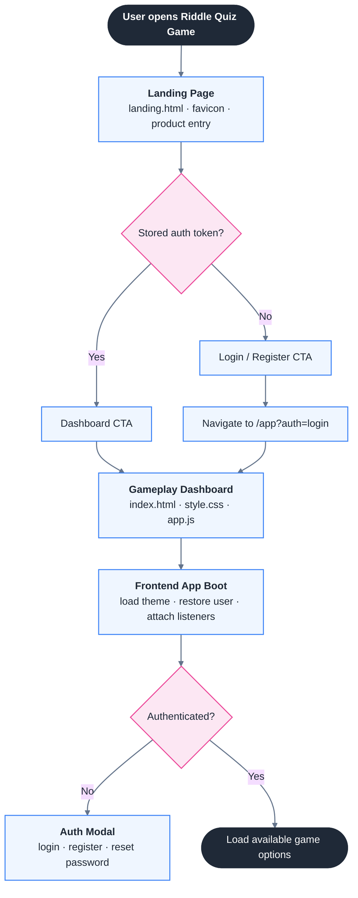

---

## 4. Authentication

The auth modal supports register, login, token refresh and logout. All four go through `auth.py` to `auth_service.py`, which handles password hashing, JWT creation, refresh-token rotation and token revocation.

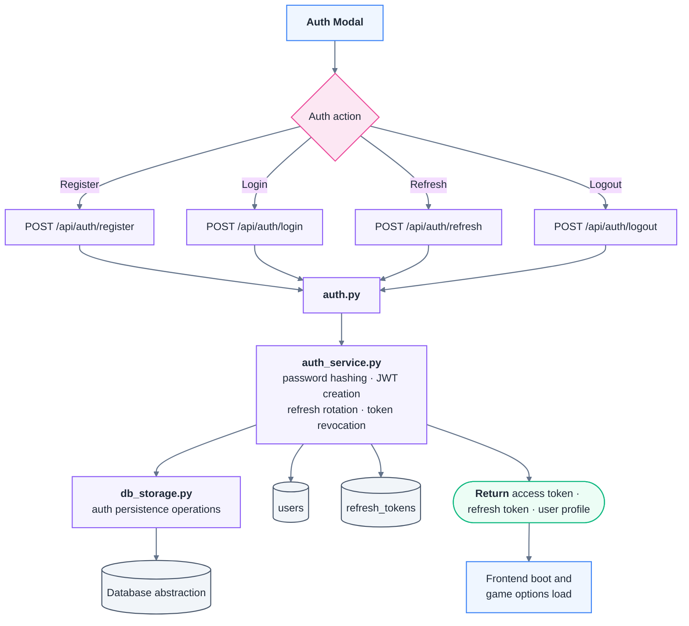

---

## 5. Persistent Data Layer

The database abstraction is environment-aware: the same storage interface sits over SQLite locally and PostgreSQL in production. Both hold the same six tables.

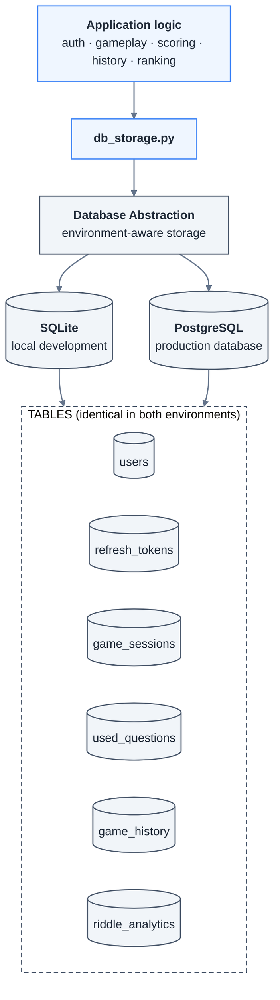

| Table | Holds |
|---|---|
| `users` | Accounts, avatars, profile data |
| `refresh_tokens` | Refresh state and revocation |
| `game_sessions` | Active rounds and hidden answers |
| `used_questions` | Anti-repetition memory |
| `game_history` | Scores, accuracy, badges, streaks |
| `riddle_analytics` | Similarity, timing, hint usage |

---

## 6. Game Options

Once authenticated, the dashboard loads the available game options. The backend reads the curated dataset and builds a map of mode, difficulty and category, which populates the selectors.

```mermaid
%%{init: {"theme": "base", "themeVariables": {"fontFamily": "Inter, Segoe UI, Helvetica, Arial, sans-serif", "primaryTextColor": "#1f2937", "lineColor": "#64748b"}, "flowchart": {"curve": "basis", "htmlLabels": true}}}%%
flowchart LR
    LOAD_OPTIONS["Load available<br/>game options"] --> OPTIONS_API["GET /api/options"]
    OPTIONS_API --> GAME_ROUTE_OPTIONS["<b>game.py</b><br/>options endpoint"]
    GAME_ROUTE_OPTIONS --> DATASET["<b>dataset.py</b><br/>load and normalize curated riddles"]
    DATASET --> RIDDLES_CSV[("<b>riddles.csv</b><br/>curated riddle dataset")]
    RIDDLES_CSV --> OPTIONS_MAP["Build options map<br/>mode → difficulty → category"]
    OPTIONS_MAP --> FORM["Populate selectors<br/>mode · difficulty · category"]
    FORM --> START_CLICK(["User clicks <b>Start Game</b>"])

    classDef entry fill:#eff6ff,stroke:#3b82f6,stroke-width:1.5px,color:#1f2937;
    classDef api   fill:#f5f3ff,stroke:#8b5cf6,stroke-width:1.5px,color:#1f2937;
    classDef store fill:#f1f5f9,stroke:#475569,stroke-width:1.5px,color:#1f2937;
    classDef start fill:#1f2937,stroke:#1f2937,color:#ffffff;
    class LOAD_OPTIONS,FORM entry;
    class OPTIONS_API,GAME_ROUTE_OPTIONS,DATASET,OPTIONS_MAP api;
    class RIDDLES_CSV store;
    class START_CLICK start;
    linkStyle default stroke:#64748b,stroke-width:1.6px
```

---

## 7. Round Setup and Mode Routing

Clicking **Start Game** calls `POST /api/start`. `game.py` validates the user, mode, difficulty and category, reads the active sessions and recently used questions, then hands off to `game_orchestrator.py`, which routes by game mode.

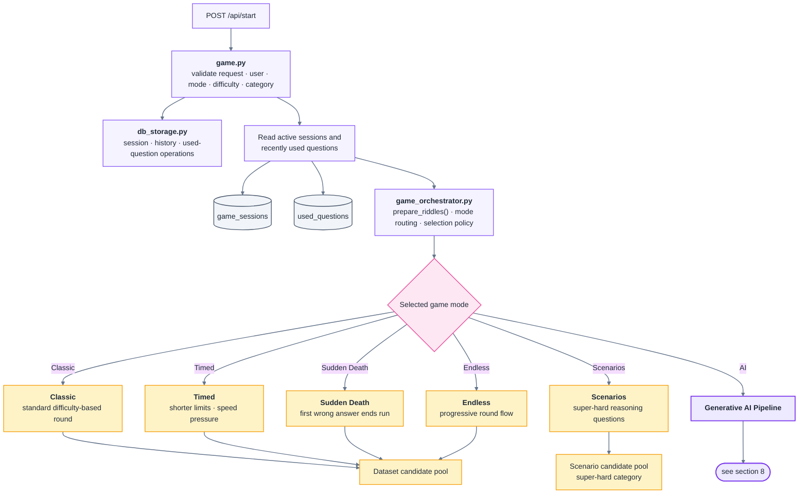

| Mode | Behaviour |
|---|---|
| **Classic** | Standard difficulty-based round |
| **Timed** | Shorter limits and speed pressure |
| **Sudden Death** | The first wrong answer ends the run |
| **Endless** | Progressive round flow |
| **Scenarios** | Super-hard reasoning questions |
| **AI** | Riddles produced by the generative AI pipeline |

---

## 8. Generative AI Pipeline

In AI mode the system builds a generation context (difficulty, category, banned questions, answer diversity), prompts the Groq LLM, then pushes every candidate through four quality stages. If too few valid riddles survive, it falls back to the curated dataset as controlled support only.

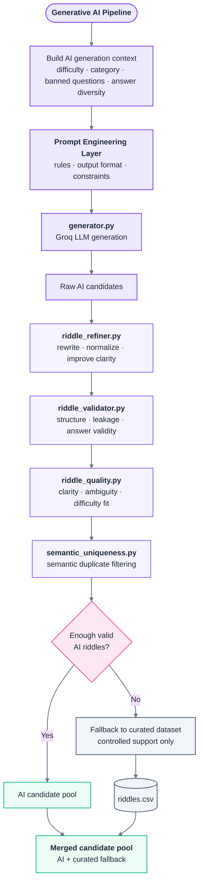

| Stage | Module | Checks |
|---|---|---|
| **Generate** | `generator.py` | Groq LLM generation from the prompt and context |
| **Refine** | `riddle_refiner.py` | Rewrite, normalise, improve clarity |
| **Validate** | `riddle_validator.py` | Structure, answer leakage, answer validity |
| **Score quality** | `riddle_quality.py` | Clarity, ambiguity, difficulty fit |
| **De-duplicate** | `semantic_uniqueness.py` | Semantic duplicate filtering |

---

## 9. Selection and Session Creation

Whichever pool the questions came from, they pass through one selection pipeline that de-duplicates, enforces answer diversity and ranks for fatigue. Questions that were recently used or reserved are filtered out. The final set is split in two: a **payload for the browser** with answers hidden, and a **secure server session** that keeps the answers.

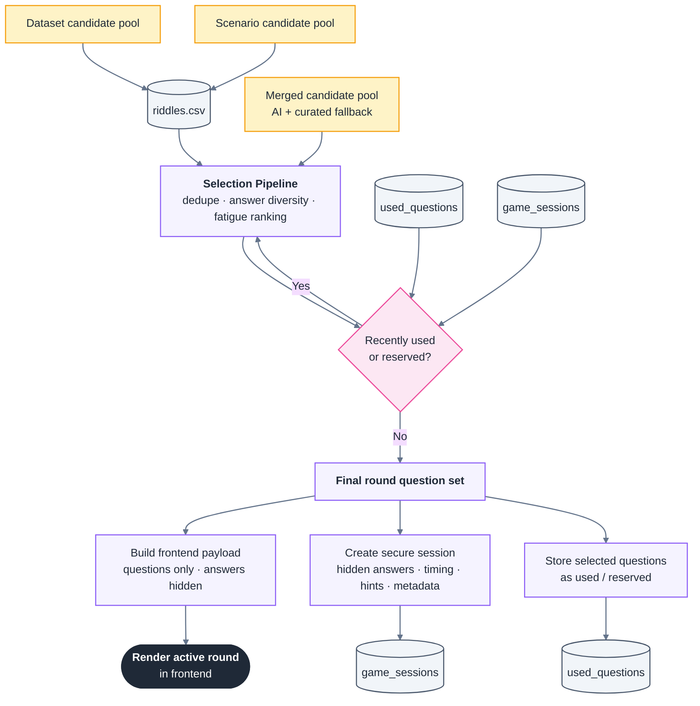

---

## 10. Play Loop

During a round the player can request hints, answer questions, and (in Sudden Death) have each answer checked live.

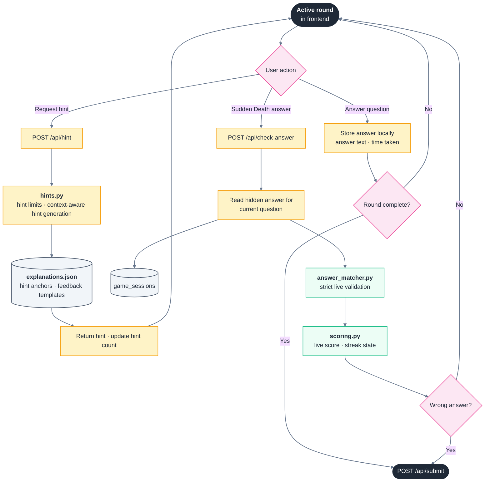

---

## 11. Submission, Scoring and Evaluation

When a round completes (or a Sudden Death run ends), `POST /api/submit` loads the stored session with its hidden answers and evaluates the whole round.

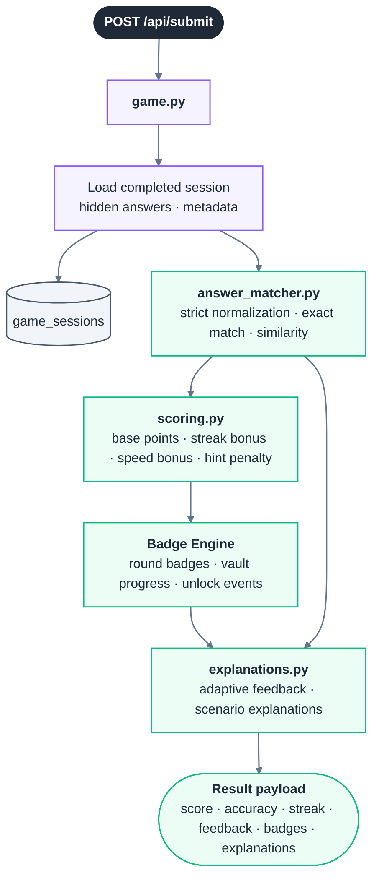

| Scoring component | Effect |
|---|---|
| **Base points** | Awarded for each correct answer |
| **Streak bonus** | Rewards consecutive correct answers |
| **Speed bonus** | Rewards faster answers |
| **Hint penalty** | Reduces points when hints are used |

---

## 12. Persistence and Dashboard Refresh

The result payload is persisted, answer analytics are recorded, and the completed session is deleted. Everything shown on the dashboard is then derived from `game_history`.

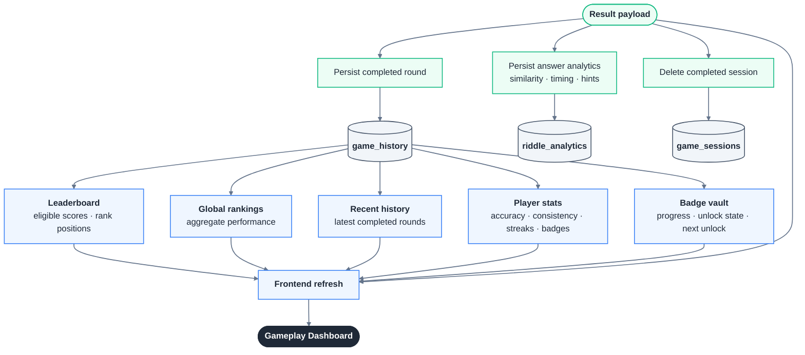

---

## 13. API Reference

| Endpoint | Method | Purpose | Handled by |
|---|:---:|---|---|
| `/api/auth/register` | POST | Create an account | `auth.py` → `auth_service.py` |
| `/api/auth/login` | POST | Authenticate and issue access and refresh tokens | `auth.py` → `auth_service.py` |
| `/api/auth/refresh` | POST | Rotate the refresh token and issue a new access token | `auth.py` → `auth_service.py` |
| `/api/auth/logout` | POST | Revoke tokens | `auth.py` → `auth_service.py` |
| `/api/options` | GET | Build the mode, difficulty and category map from the curated dataset | `game.py` |
| `/api/start` | POST | Validate the request, select questions, create a secure session | `game.py` → `game_orchestrator.py` |
| `/api/hint` | POST | Return a context-aware hint and update the hint count | `game.py` → `hints.py` |
| `/api/check-answer` | POST | Live strict answer validation (Sudden Death) | `game.py` → `answer_matcher.py` |
| `/api/submit` | POST | Final evaluation, scoring, badges and persistence | `game.py` |

---

## 14. Module Map

| Module / file | Responsibility |
|---|---|
| `landing.html` | Landing page, favicon and product entry |
| `index.html` · `style.css` · `app.js` | Gameplay dashboard, styling and frontend logic |
| `auth.py` | Auth routes |
| `auth_service.py` | Password hashing, JWT creation, refresh rotation, token revocation |
| `db_storage.py` | Persistence operations for auth, sessions, history and used questions |
| `game.py` | Game routes: options, start, hint, check-answer, submit |
| `dataset.py` | Loads and normalises the curated riddles |
| `game_orchestrator.py` | `prepare_riddles()`, mode routing and selection policy |
| `generator.py` | Groq LLM riddle generation |
| `riddle_refiner.py` | Rewrites, normalises and improves clarity |
| `riddle_validator.py` | Checks structure, leakage and answer validity |
| `riddle_quality.py` | Scores clarity, ambiguity and difficulty fit |
| `semantic_uniqueness.py` | Filters semantic duplicates |
| `hints.py` | Hint limits and context-aware hint generation |
| `answer_matcher.py` | Strict normalisation, exact match and similarity |
| `scoring.py` | Base points, streak bonus, speed bonus, hint penalty, live score |
| `explanations.py` | Adaptive feedback and scenario explanations |
| `riddles.csv` | Curated riddle dataset |
| `explanations.json` | Hint anchors and feedback templates |

---

## 15. Complete End-to-End Diagram

The full runtime path in a single diagram. The sections above break it into focused views.

<b>Show the complete flowchart</b>

```mermaid
flowchart TD

%% =====================================================
%% ENTRY / LANDING PAGE
%% =====================================================
START["User opens Riddle Quiz Game"] --> LANDING["Landing Page<br/>landing.html · favicon · product entry"]

LANDING --> LANDING_AUTH{"Stored auth token?"}

LANDING_AUTH -- "No" --> LOGIN_CTA["Login / Register CTA"]
LOGIN_CTA --> APP_AUTH["Navigate to /app?auth=login"]

LANDING_AUTH -- "Yes" --> DASH_CTA["Dashboard CTA"]
DASH_CTA --> APP["Gameplay Dashboard<br/>index.html · style.css · app.js"]

APP_AUTH --> APP

%% =====================================================
%% FRONTEND APPLICATION BOOT
%% =====================================================
APP --> INIT["Frontend App Boot<br/>load theme · restore user · attach listeners"]
INIT --> AUTH_CHECK{"Authenticated?"}

AUTH_CHECK -- "No" --> AUTH_MODAL["Auth Modal<br/>login · register · reset password"]
AUTH_CHECK -- "Yes" --> LOAD_OPTIONS["Load available game options"]

%% =====================================================
%% AUTHENTICATION FLOW
%% =====================================================
AUTH_MODAL --> AUTH_ACTION{"Auth action"}

AUTH_ACTION -- "Register" --> REGISTER_API["POST /api/auth/register"]
AUTH_ACTION -- "Login" --> LOGIN_API["POST /api/auth/login"]
AUTH_ACTION -- "Refresh" --> REFRESH_API["POST /api/auth/refresh"]
AUTH_ACTION -- "Logout" --> LOGOUT_API["POST /api/auth/logout"]

REGISTER_API --> AUTH_ROUTE["auth.py"]
LOGIN_API --> AUTH_ROUTE
REFRESH_API --> AUTH_ROUTE
LOGOUT_API --> AUTH_ROUTE

AUTH_ROUTE --> AUTH_SERVICE["auth_service.py<br/>password hashing · JWT creation · refresh rotation · token revocation"]

AUTH_SERVICE --> DBSTORE_AUTH["db_storage.py<br/>auth persistence operations"]

%% =====================================================
%% DATABASE ENVIRONMENT
%% =====================================================
subgraph DATA["Persistent Data Layer"]
    DB_ABS["Database Abstraction<br/>environment-aware storage"]

    SQLITE[("SQLite<br/>local development")]
    POSTGRES[("PostgreSQL<br/>production database")]

    USERS[("users<br/>accounts · avatars · profile data")]
    TOKENS[("refresh_tokens<br/>refresh state · revocation")]
    SESSIONS[("game_sessions<br/>active rounds · hidden answers")]
    USED[("used_questions<br/>anti-repetition memory")]
    HISTORY[("game_history<br/>scores · accuracy · badges · streaks")]
    ANALYTICS[("riddle_analytics<br/>similarity · timing · hint usage")]
end

DBSTORE_AUTH --> DB_ABS
DB_ABS --> SQLITE
DB_ABS --> POSTGRES

SQLITE --> USERS
SQLITE --> TOKENS
SQLITE --> SESSIONS
SQLITE --> USED
SQLITE --> HISTORY
SQLITE --> ANALYTICS

POSTGRES --> USERS
POSTGRES --> TOKENS
POSTGRES --> SESSIONS
POSTGRES --> USED
POSTGRES --> HISTORY
POSTGRES --> ANALYTICS

AUTH_SERVICE --> USERS
AUTH_SERVICE --> TOKENS

AUTH_SERVICE --> AUTH_SUCCESS["Return access token · refresh token · user profile"]
AUTH_SUCCESS --> INIT
AUTH_SUCCESS --> LOAD_OPTIONS

%% =====================================================
%% OPTIONS FLOW
%% =====================================================
LOAD_OPTIONS --> OPTIONS_API["GET /api/options"]
OPTIONS_API --> GAME_ROUTE_OPTIONS["game.py<br/>options endpoint"]

GAME_ROUTE_OPTIONS --> DATASET["dataset.py<br/>load and normalize curated riddles"]
DATASET --> RIDDLES_CSV[("riddles.csv<br/>curated riddle dataset")]

RIDDLES_CSV --> OPTIONS_MAP["Build options map<br/>mode → difficulty → category"]
OPTIONS_MAP --> FORM["Populate selectors<br/>mode · difficulty · category"]

%% =====================================================
%% START ROUND
%% =====================================================
FORM --> START_CLICK["User clicks Start Game"]
START_CLICK --> START_API["POST /api/start"]

START_API --> GAME_ROUTE["game.py<br/>validate request · user · mode · difficulty · category"]
GAME_ROUTE --> DBSTORE_GAME["db_storage.py<br/>session · history · used-question operations"]

DBSTORE_GAME --> DB_ABS

GAME_ROUTE --> ACTIVE_STATE["Read active sessions and recently used questions"]
ACTIVE_STATE --> SESSIONS
ACTIVE_STATE --> USED

ACTIVE_STATE --> ORCH["game_orchestrator.py<br/>prepare_riddles() · mode routing · selection policy"]

%% =====================================================
%% MODE ROUTING
%% =====================================================
ORCH --> MODE_CHECK{"Selected game mode"}

MODE_CHECK -- "Classic" --> CLASSIC["Classic Mode<br/>standard difficulty-based round"]
MODE_CHECK -- "Timed" --> TIMED["Timed Mode<br/>shorter limits · speed pressure"]
MODE_CHECK -- "Sudden Death" --> SUDDEN["Sudden Death<br/>first wrong answer ends run"]
MODE_CHECK -- "Endless" --> ENDLESS["Endless Mode<br/>progressive round flow"]
MODE_CHECK -- "Scenarios" --> SCENARIOS["Scenario Mode<br/>super-hard reasoning questions"]
MODE_CHECK -- "AI" --> AI_PIPE["Generative AI Pipeline"]

%% =====================================================
%% GENERATIVE AI PIPELINE
%% =====================================================
AI_PIPE --> AI_CONTEXT["Build AI generation context<br/>difficulty · category · banned questions · answer diversity"]
AI_CONTEXT --> AI_PROMPT["Prompt Engineering Layer<br/>rules · output format · constraints"]
AI_PROMPT --> GENERATOR["generator.py<br/>Groq LLM generation"]

GENERATOR --> RAW_AI["Raw AI candidates"]
RAW_AI --> REFINER["riddle_refiner.py<br/>rewrite · normalize · improve clarity"]
REFINER --> VALIDATOR["riddle_validator.py<br/>structure · leakage · answer validity"]
VALIDATOR --> QUALITY["riddle_quality.py<br/>clarity · ambiguity · difficulty fit"]
QUALITY --> SEMANTIC["semantic_uniqueness.py<br/>semantic duplicate filtering"]

SEMANTIC --> AI_READY{"Enough valid AI riddles?"}

AI_READY -- "No" --> DATASET_FALLBACK["Fallback to curated dataset<br/>controlled support only"]
DATASET_FALLBACK --> RIDDLES_CSV

AI_READY -- "Yes" --> AI_SELECT["AI candidate pool"]
RIDDLES_CSV --> MERGED_POOL["Merged candidate pool<br/>AI + curated fallback"]
AI_SELECT --> MERGED_POOL

%% =====================================================
%% NON-AI SELECTION PIPELINE
%% =====================================================
CLASSIC --> DATASET_POOL["Dataset candidate pool"]
TIMED --> DATASET_POOL
SUDDEN --> DATASET_POOL
ENDLESS --> DATASET_POOL
SCENARIOS --> SCENARIO_POOL["Scenario candidate pool<br/>super-hard category"]

DATASET_POOL --> RIDDLES_CSV
SCENARIO_POOL --> RIDDLES_CSV

RIDDLES_CSV --> SELECT_PIPE["Selection Pipeline<br/>dedupe · answer diversity · fatigue ranking"]
MERGED_POOL --> SELECT_PIPE

SELECT_PIPE --> RECENT_CHECK{"Recently used or reserved?"}
USED --> RECENT_CHECK
SESSIONS --> RECENT_CHECK

RECENT_CHECK -- "Yes" --> SELECT_PIPE
RECENT_CHECK -- "No" --> FINAL_SET["Final round question set"]

%% =====================================================
%% SESSION CREATION
%% =====================================================
FINAL_SET --> PAYLOAD_BUILD["Build frontend payload<br/>questions only · answers hidden"]
FINAL_SET --> SESSION_CREATE["Create secure session<br/>hidden answers · timing · hints · metadata"]

SESSION_CREATE --> SESSIONS
FINAL_SET --> USED_WRITE["Store selected questions as used/reserved"]
USED_WRITE --> USED

PAYLOAD_BUILD --> FRONTEND_GAME["Render active round in frontend"]

%% =====================================================
%% PLAY LOOP
%% =====================================================
FRONTEND_GAME --> USER_ACTION{"User action"}

USER_ACTION -- "Request hint" --> HINT_API["POST /api/hint"]
HINT_API --> GAME_ROUTE
GAME_ROUTE --> HINTS["hints.py<br/>hint limits · context-aware hint generation"]
HINTS --> EXPLANATIONS[("explanations.json<br/>hint anchors · feedback templates")]
EXPLANATIONS --> HINT_RESPONSE["Return hint · update hint count"]
HINT_RESPONSE --> FRONTEND_GAME

USER_ACTION -- "Answer question" --> ANSWER_BUFFER["Store answer locally<br/>answer text · time taken"]
ANSWER_BUFFER --> ROUND_COMPLETE{"Round complete?"}

USER_ACTION -- "Sudden Death answer" --> CHECK_API["POST /api/check-answer"]
CHECK_API --> GAME_ROUTE
GAME_ROUTE --> LIVE_SESSION_READ["Read hidden answer for current question"]
LIVE_SESSION_READ --> SESSIONS

LIVE_SESSION_READ --> LIVE_MATCH["answer_matcher.py<br/>strict live validation"]
LIVE_MATCH --> LIVE_SCORE["scoring.py<br/>live score · streak state"]
LIVE_SCORE --> SUDDEN_WRONG{"Wrong answer?"}

SUDDEN_WRONG -- "Yes" --> SUBMIT_API["POST /api/submit"]
SUDDEN_WRONG -- "No" --> FRONTEND_GAME

ROUND_COMPLETE -- "No" --> FRONTEND_GAME
ROUND_COMPLETE -- "Yes" --> SUBMIT_API

%% =====================================================
%% SUBMISSION AND EVALUATION
%% =====================================================
SUBMIT_API --> GAME_ROUTE
GAME_ROUTE --> SESSION_READ["Load completed session<br/>hidden answers · metadata"]
SESSION_READ --> SESSIONS

SESSION_READ --> MATCH["answer_matcher.py<br/>strict normalization · exact match · similarity"]
MATCH --> SCORE["scoring.py<br/>base points · streak bonus · speed bonus · hint penalty"]
SCORE --> BADGE_ENGINE["Badge Engine<br/>round badges · vault progress · unlock events"]

BADGE_ENGINE --> EXPLAIN_ENGINE["explanations.py<br/>adaptive feedback · scenario explanations"]
MATCH --> EXPLAIN_ENGINE

EXPLAIN_ENGINE --> RESULT_PAYLOAD["Build result payload<br/>score · accuracy · streak · feedback · badges · explanations"]

%% =====================================================
%% PERSISTENCE AFTER ROUND
%% =====================================================
RESULT_PAYLOAD --> SAVE_HISTORY["Persist completed round"]
SAVE_HISTORY --> HISTORY

MATCH --> SAVE_ANALYTICS["Persist answer analytics<br/>similarity · timing · hints"]
SAVE_ANALYTICS --> ANALYTICS

RESULT_PAYLOAD --> DELETE_SESSION["Delete completed session"]
DELETE_SESSION --> SESSIONS

%% =====================================================
%% RANKING AND DASHBOARD REFRESH
%% =====================================================
HISTORY --> LEADERBOARD["Compute leaderboard<br/>eligible scores · rank positions"]
HISTORY --> GLOBAL["Compute global rankings<br/>aggregate performance"]
HISTORY --> HISTORY_UI["Recent history<br/>latest completed rounds"]
HISTORY --> STATS["Player stats<br/>accuracy · consistency · streaks · badges"]
HISTORY --> VAULT["Badge vault<br/>progress · unlock state · next unlock"]

LEADERBOARD --> FRONTEND_REFRESH["Frontend refresh"]
GLOBAL --> FRONTEND_REFRESH
HISTORY_UI --> FRONTEND_REFRESH
STATS --> FRONTEND_REFRESH
VAULT --> FRONTEND_REFRESH
RESULT_PAYLOAD --> FRONTEND_REFRESH

FRONTEND_REFRESH --> APP

%% =====================================================
%% STYLING
%% =====================================================
classDef entry    fill:#eff6ff,stroke:#3b82f6,stroke-width:1.5px,color:#1f2937
classDef decision fill:#fce7f3,stroke:#ec4899,stroke-width:1.5px,color:#1f2937
classDef auth     fill:#f5f3ff,stroke:#8b5cf6,stroke-width:1.5px,color:#1f2937
classDef data     fill:#f1f5f9,stroke:#475569,stroke-width:1.5px,color:#1f2937
classDef game     fill:#fef3c7,stroke:#f59e0b,stroke-width:1.5px,color:#1f2937
classDef ai       fill:#ede9fe,stroke:#7c3aed,stroke-width:1.5px,color:#1f2937
classDef score    fill:#ecfdf5,stroke:#10b981,stroke-width:1.5px,color:#1f2937

class START,LANDING,LOGIN_CTA,APP_AUTH,DASH_CTA,APP,INIT,FRONTEND_GAME,FRONTEND_REFRESH,FORM,START_CLICK entry
class LANDING_AUTH,AUTH_CHECK,AUTH_ACTION,MODE_CHECK,AI_READY,RECENT_CHECK,USER_ACTION,ROUND_COMPLETE,SUDDEN_WRONG decision
class AUTH_MODAL,REGISTER_API,LOGIN_API,REFRESH_API,LOGOUT_API,AUTH_ROUTE,AUTH_SERVICE,DBSTORE_AUTH,AUTH_SUCCESS auth
class DB_ABS,SQLITE,POSTGRES,USERS,TOKENS,SESSIONS,USED,HISTORY,ANALYTICS,RIDDLES_CSV,EXPLANATIONS data
class LOAD_OPTIONS,OPTIONS_API,GAME_ROUTE_OPTIONS,DATASET,OPTIONS_MAP,START_API,GAME_ROUTE,DBSTORE_GAME,ACTIVE_STATE,ORCH,CLASSIC,TIMED,SUDDEN,ENDLESS,SCENARIOS,DATASET_POOL,SCENARIO_POOL,SELECT_PIPE,FINAL_SET,PAYLOAD_BUILD,SESSION_CREATE,USED_WRITE,HINT_API,HINTS,HINT_RESPONSE,ANSWER_BUFFER,CHECK_API,LIVE_SESSION_READ,SUBMIT_API game
class AI_PIPE,AI_CONTEXT,AI_PROMPT,GENERATOR,RAW_AI,REFINER,VALIDATOR,QUALITY,SEMANTIC,DATASET_FALLBACK,AI_SELECT,MERGED_POOL ai
class LIVE_MATCH,LIVE_SCORE,SESSION_READ,MATCH,SCORE,BADGE_ENGINE,EXPLAIN_ENGINE,RESULT_PAYLOAD,SAVE_HISTORY,SAVE_ANALYTICS,DELETE_SESSION,LEADERBOARD,GLOBAL,HISTORY_UI,STATS,VAULT score
```

---

[Back to top](#system-flow)

